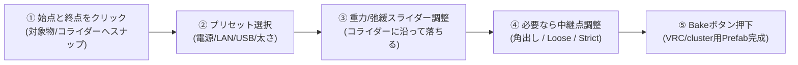

# 新生 CableGenerator (V2) 要件定義・基本設計書

---

## 1. プロジェクト概要・リメイクの目的

### 1.1 背景と課題
現行の CableGenerator はベジェスプラインに沿ってケーブルメッシュを生成する有用なツールですが、以下の課題を抱えていました：
1. **Unity Splines パッケージへの外部依存**:
   - Unity の `com.unity.splines` パッケージの導入が必須であり、導入の手間やバージョン差異による互換性問題が存在。
2. **曲線編集の学習コスト・操作摩擦**:
   - ベジェハンドルの操作（接線方向や長さの微調整）は初心者にとって扱いづらく、自然なケーブルのたるみや取り回しを作るのに多くの手数を要する。
3. **ポリゴン効率の非最適化**:
   - 一様なセグメント分割を行っているため、直線部分でも無駄にポリゴンを消費し、急カーブ部分ではカクつきが生じる。
4. **環境追従性（物理・コライダー）の不足**:
   - 壁や床、障害物に沿わせる作業が完全手動であり、リアリティのある配線配置に時間がかかる。
5. **Inspector 依存の UI**:
   - パラメータ調整のために Inspector と SceneView を頻繁に往復する必要があり、dennokoworks の最新ツール群（MaskMakerV4, StitchMaker 等）の洗練された Scene 完結型 UX に比べて操作体験が劣る。

### 1.2 リメイクの基本方針（3大軸）
1. **Splines パッケージ完全脱却（ゼロ依存・高パフォーマンス）**:
   - 外部パッケージに一切依存せず、Unity 標準機能（C# 標準数学・`Vector3`・`Mesh`）のみで完結。インポートするだけですぐに動作する軽量設計。
2. **StitchMaker 流の直観的カーブ操作**:
   - **基本は完全自動補間**: 始点・終点・中継点を置くだけで滑らかな曲線が自動生成。
   - **自由な中継点と拘束度**: 中継点を任意に追加可能。中継点に「厳密に通す（Strict）」か「緩やかに寄せる（Loose）」かを直感的に切り替え。
   - **必要な時だけ角出し・ハンドル編集**: 鋭角コーナーや手動ベジェハンドル調整へのシームレスな移行。
3. **MaskMakerV4 流の Scene 完結型 UI/UX**:
   - **シーンオーバーレイ・ツールバー（Capsule Overlay）** と **パイメニュー（Radial Menu）**、カーソル付近のヒント・トーストにより、Inspector を触らずシーンビュー内で全作業が完結。
4. **競合を圧倒するスマート機能群**:
   - **曲率適応型（非均等）ポリゴン分割**: 直線部は極小ポリゴン、急カーブは高密度で自動最適化（ポリゴン数 50〜80% 削減）。
   - **リアルタイム重力・コライダーたわみシミュレーション**: 長さを指定して落とすだけで、床や障害物（Collider）の上にリアルに沿って弛緩静止。
   - **プラグ・端子プリセット & 質感プリセット**: USB-C, 3.5mmジャック, LAN等のプラグが自動接線追従で結合。オリジナルプリセットの保存・呼出に対応。
   - **ワンクリック・クリーン Prefab 出力**: VRChat / cluster 向けにランタイムスクリプトゼロの Prefab を即座に Bake 出力。

---

## 2. ターゲットユーザーと想定ユースケース

### 2.1 ターゲットユーザー
- **VRChat / cluster ワールドクリエイター**: 部屋の配線、サイバーパンクなパイプ群、機械室のケーブルハーネス、天井の吊り下げワイヤー等の高速配置。
- **3D アバター・衣装モデラー**: ヘッドホンケーブル、胸元や腰のコード装飾、サイバー系アタッチメントの作成。
- **Unity レベルデザイナー / インディゲーム開発者**: ダンジョンや工場の配管配線を素早く配置・ベイク。

### 2.2 主要ユースケース & 理想の作業フロー（10秒クッキング）

- **説明書不要の直観性**: 始点と終点を選ぶだけで即座にケーブルが出現。たるみ具合を決めて「Bake」を押せば完成。

---

## 3. 機能要件

### 3.1 曲線生成・補間システム（Splines パッケージフリー）

| 機能 ID | 項目 | 詳細仕様 |
|---|---|---|
| **CURV-01** | **始点・終点自動生成** | オブジェクト指定、またはシーン上のコライダー/メッシュ表面を 2 クリックすることで始点と終点をつなぐ初期ケーブルを生成。 |
| **CURV-02** | **自動補間カーブ（Default）** | StitchMaker の Centripetal Catmull-Rom スタイルの自動補間アルゴリズムを採用。極端なオーバーシュートやねじれを防ぎ、自然で美しい曲線を自動維持。 |
| **CURV-03** | **中継点（Waypoint）の自由追加・削除** | 既存のケーブルライン上をクリック、またはショートカット（`Ctrl + クリック`）で任意の位置に中継点を即時挿入。 |
| **CURV-04** | **中継点の拘束モード（Strict vs Loose）** | **Strict（厳密通過）**: ノードの座標をカーブが 100% 通過。<br/>**Loose（緩やか追従 / Tension）**: ノード位置にカーブがバネや磁石のように引っ張られるが、角ばらずに自然なテンションで通過。 |
| **CURV-05** | **コーナーモード（角出し）** | 直角パイプや壁のコーナーに這わせるための鋭角（Sharp/Corner）切り替え機能。前後のハンドル長を 0 にし、曲率無限大の鋭角を形成。 |
| **CURV-06** | **手動ベジェハンドル調整（Manual Handles）** | 必要なノードのみ「手動ハンドル化」可能。現在の自動ハンドル角をベイクして引き継ぎ、ハンドルをドラッグして微調整。 |
| **CURV-07** | **ケーブル長・たるみ制御** | **Direct（最短距離）**, **Ratio（たるみ率 %）**, **Fixed Length（実長指定 m）** の 3 モード。長さを伸ばすと物理重力シミュレーションと連動してたわみが発生。 |

---

### 3.2 物理シミュレーション & コライダー接触（Physics & Collision）

| 機能 ID | 項目 | 詳細仕様 |
|---|---|---|
| **PHYS-01** | **懸垂線（Catenary）/ 重力たるみ** | 始点・終点間、および各中継点間のたるみ量を重力ベクトル（既定は下方向 `-Y`）に沿って自然に垂下計算。 |
| **PHYS-02** | **Verlet 緩和シミュレーション** | 編集モード中、軽量な Verlet パーティクル鎖による弛緩シミュレーションを実行。 |
| **PHYS-03** | **コライダー衝突・静止（Obstacle Draping）** | シーン内の `Collider`（床、机、突起物、配管）に対してレイキャストおよび球衝突判定を行い、ケーブルが障害物の上をまたいでリアルに落下・接触静止。 |
| **PHYS-04** | **ピン留め（Pinning）** | 始点・終点および特定の中継点を「空間固定（ピン留め）」とし、その間の中間セグメントのみを重力で垂らす制御。 |
| **PHYS-05** | **Simulate / Settle ボタン** | シミュレーションをリアルタイムプレビューするか、ワンクリックで「物理安定化（Settle）」させて中継点に焼き込むかを選択可能。 |

---

### 3.3 メッシュ生成 & 曲率適応型ポリゴン最適化

| 機能 ID | 項目 | 詳細仕様 |
|---|---|---|
| **MESH-01** | **曲率適応型分割（Adaptive Tessellation）** | 直線区間はポリゴン分割を最小（頂点数を大幅節約）にし、急カーブ部分のみ角度許容値（例: 最大 5° ごと）に基づいて自動で密に分割。従来の均等分割比でポリゴン数を 50〜80% 削減。 |
| **MESH-02** | **ねじれ防止座標系（RMF: Rotation Minimizing Frames）** | 空間内で 3 次元的に曲がりくねったケーブルでも、法線が裏返ったり不自然にねじれたりしない Double Reflection RMF アルゴリズムを搭載。 |
| **MESH-03** | **断面プロファイル（Cross-Section Profiles）** | ・**Round**: 一般的な円形断面（角数 4〜16）<br/>・**Flat / Ribbon**: リボンケーブル、フラット配線<br/>・**Bundled**: 3〜6本の束線ケーブル<br/>・**Twisted**: 2〜4本のより線ケーブル<br/>・**Spiral Tube**: 蛇腹状のスパイラル保護チューブ |
| **MESH-04** | **端子・プラグアタッチメント（End Caps / Plugs）** | ケーブルの始点・終点の接線ベクトル（Tangent）および法線に自動整列してキャップメッシュを統合（または子オブジェクト結合）。<br/>付属プリセット: USB-C, 3.5mm 音声ミニプラグ, LAN(RJ45), 電源プラグ, 工業用コネクタ, 切りっぱなし芯線。 |
| **MESH-05** | **テクスチャ UV マッピング** | ケーブルの長さに応じた自動タイリング UV0 展開。UV1（ライトマップ用アンラップ）の自動生成トグル。 |

---

### 3.4 プリセット管理システム

| 機能 ID | 項目 | 詳細仕様 |
|---|---|---|
| **PRES-01** | **組み込みプリセット（Built-in Presets）** | 太さ、断面、たるみ具合、質感マテリアル、端子プラグを組み合わせた実用的なプリセットを提供（「LANケーブル」「オーディオコード」「電源コード」「束ねサイバーケーブル」「工場用高圧配管」など）。 |
| **PRES-02** | **カスタムプリセット作成・登録** | 現在の編集設定（プロファイル、太さ、マテリアル、端子、たわみ設定）をワンクリックで「新規プリセットとして保存」可能（`.asset` または JSON）。 |
| **PRES-03** | **ビジュアルプリセットピッカー** | サムネイル付きの直観的なプリセット選択 UI。 |

---

### 3.5 出力・Bake・プラットフォーム最適化

| 機能 ID | 項目 | 詳細仕様 |
|---|---|---|
| **BAKE-01** | **ワンクリック Bake** | メッシュを `.asset` にシリアライズ保存し、ランタイムスクリプトを一切含まない純粋な GameObject（`MeshFilter` + `MeshRenderer`）を生成。 |
| **BAKE-02** | **Prefab エクスポート（VRChat / cluster 対応）** | 階層構造、マテリアル、プラグメッシュをひとまとめにしたクリーンな Prefab をワンクリック生成。 |
| **BAKE-03** | **PhysBones 構成オプション（任意）** | VRChat 向けに、垂れ下がるケーブルや揺れるコードをアバター/ワールドで動かすための `VRCPhysBone` コンポーネントおよびボーンチェーンの自動生成セットアップ機能（オプション）。 |

---

## 4. UI / UX 設計（dennokoworks デザインシステム準拠）

MaskMakerV4 および StitchMaker で確立されたデザインパターンを全面採用し、**マニュアルを読まなくても見たまま直感的に操作できる環境** を実現します。

### 4.1 シーンオーバーレイ・ツールバー（Capsule Overlay）
Unity 2022+ の `UnityEditor.Overlays.Overlay` システムと `ITransientOverlay` を使用。CableGenerator の編集中のみシーンビュー内に浮動表示されます。

```
┌────────────────────────────────────────────────────────────────────────┐
│  [+] 追加  |  ~ 滑らか  |  /| 角出し  |  ↓ 物理落下  | [プリセット▼] | [ Bake ]  │
└────────────────────────────────────────────────────────────────────────┘
```
- **追加モード（Draw/Add）**: シーン上の表面をクリックして中継点を連続配置。
- **カーブモード切り替え**: 選択中のノードを「滑らか（Auto）」「角（Sharp）」「緩やか（Loose）」に切り替え。
- **物理落下（Gravity Drop）**: ワンクリックで現在のケーブルをコライダーへ物理的に着地・安定化。
- **Bake ボタン**: 完了時にボタンが緑色にフラッシュ（`DennokoSceneUI.FlashSuccess`）し、カーソル脇にトースト通知。

### 4.2 パイメニュー（DennokoRadialMenu）
シーンビュー上で中継点やケーブルを右クリック（または `Space` / `C` キー）した際、マウスカーソルの周囲に円形展開する直観的メニュー。

```
                    [ 12:00 ]
                  物理落下 (Drop)
                       ▲
                       │
  [ 9:00 ]             │             [ 3:00 ]
 プリセット切替 ◄───────┼───────►  ノードモード切替
 (Presets)             │          (Smooth / Sharp / Loose)
                       │
                       ▼
                    [ 6:00 ]
                   Bake & 保存
```
- マウスを目的の方向に少し動かして離すだけで決定できるため、熟練者は 0.2 秒で操作可能。

### 4.3 カーソルフィードバック & 迷い検知ヒント（DennokoSceneFeedback）
- **操作ガイドバッジ**: 
  - `Ctrl + Click`: 線上に中継点を追加
  - `Shift + Drag`: コライダー表面にスナップ移動
  - `Alt + Drag`: ベジェハンドルの個別調整
- **迷い検知**: ケーブルを選択したまま操作が 2 秒止まった際、シーン下部に「始点・終点をクリックして配置」「物理落下ボタンで弛緩できます」といった 1 行の優しいヒントを表示。
- **トースト通知**: Bake 完了時に「Saved: Assets/.../Cable_01.prefab」をカーソル脇にフロート表示し、クリックで Project 内のファイルを即座に Ping（ハイライト）。

---

## 5. アーキテクチャ設計

### 5.1 ディレクトリ構成（予定）
```
Assets/dennokoworks/CableGenerator/
├── Editor/
│   ├── dennokoworks.CableGenerator.Editor.asmdef
│   ├── Core/                           ← 曲線計算・物理・メッシュ生成ロジック
│   │   ├── CableMath.cs                ← Catmull-Rom, Bezier, RMF
│   │   ├── CurvatureAdaptiveSampler.cs ← 曲率適応型サンプラー
│   │   ├── CableVerletPhysics.cs       ← 重力・コライダー衝突緩和シミュレータ
│   │   └── CableMeshBuilder.cs         ← 断面押出・UV・頂点生成
│   ├── Data/                           ← データモデル
│   │   ├── CableData.cs                ← ノードリスト、設定パラメータ
│   │   ├── CableNode.cs                ← 単一ノード定義（位置・ハンドル・属性）
│   │   └── CablePreset.cs              ← プリセット ScriptableObject
│   ├── UI/                             ← UI 実装
│   │   ├── CableCapsuleOverlay.cs      ← シーンオーバーレイツールバー
│   │   ├── CableRadialMenu.cs          ← パイメニュー
│   │   ├── CableSceneManipulator.cs    ← シーン上ハンドル・クリック・スナップ
│   │   ├── CablePresetPicker.cs        ← プリセット選択ウィンドウ
│   │   └── CableGeneratorInspector.cs  ← 最小限の補助 Inspector
│   └── Export/                         ← ベイク・Prefab エクスポート
│       ├── CableBaker.cs
│       └── CablePhysBoneSetup.cs       ← (任意) VRChat PhysBone 自動構築
├── Runtime/
│   ├── dennokoworks.CableGenerator.Runtime.asmdef
│   ├── CableProfile.cs                 ← 断面プロファイル ScriptableObject 基底
│   ├── Profiles/                       ← 組み込みプロファイル（Round, Flat, Spiral等）
│   └── Presets/                        ← 組み込みプリセットアセット
├── Material/                           ← デフォルトマテリアル
└── Docs/                               ← ドキュメント
    ├── 要件定義書_V2.md                 ← 本ドキュメント
    └── 実装設計_V2.md                   ← 詳細設計書（順次作成）
```

### 5.2 データ構造（CableData & CableNode）
```csharp
public enum NodeInterpolationMode
{
    AutoSmooth = 0,    // 自動滑らか補間（Catmull-Rom）
    SharpCorner = 1,   // 鋭角コーナー
    ManualBezier = 2,  // 手動ベジェハンドル
}

[Serializable]
public class CableNode
{
    public Vector3 position;       // ローカルまたはワールド座標
    public Vector3 normal;         // サーフェス法線（スナップ時）
    public Vector3 handleIn;       // 手動時のみ有効な相対ハンドル
    public Vector3 handleOut;
    public NodeInterpolationMode mode = NodeInterpolationMode.AutoSmooth;
    
    [Range(0f, 1f)]
    public float strictness = 1f;  // 1.0: 厳密通過 (Strict), <1.0: 緩やか通過 (Loose)
    public float radiusMultiplier = 1f; // 個別ノードでの太さスケール
    public bool isPinned = true;   // 物理シミュレーション時の固定点
}
```

### 5.3 曲率適応型非均等サンプリングのアルゴリズム
1. 各セグメント（ノード $i \to i+1$）を初期サンプル（端点 2 点）。
2. 中間点 $t = 0.5$ を評価。
3. 直線近似（弦）からの垂直距離（Chord Error）と、両端点での接線ベクトル間の角度差 $\Delta \theta$ を計算。
4. 角度差がしきい値（例: $\Delta \theta > 4^\circ$）を超える場合、または距離誤差が大きい場合は再帰的に二分割（Subdivide）。
5. 曲率の小さい直線区間はわずか 1〜2 セグメントで済み、急カーブ部分のみ滑らかな 16〜32 分割が自動適用される。

---

## 6. 競合ツールとの差別化・優位性まとめ

| 比較項目 | 競合想定ツール | 新生 CableGenerator (V2) | 優位性・勝因 |
|---|---|---|---|
| **パッケージ依存** | Unity Splines や外部アセット依存の可能性大 | **完全ゼロ依存（Unity 標準のみ）** | インポート一発ですぐ動き、環境を選ばない。プロジェクトを壊さない。 |
| **曲線制御の扱いやすさ** | ベジェハンドルの調整が必要でコツがいる | **StitchMaker 流の自動補間 + Loose/Strict スライダー + ワンクリック角出し** | 置くだけで綺麗な線になり、角の配管も自然なたるみも迷わず作れる。 |
| **ポリゴン効率** | 均等分割（直線でも無駄にポリゴンを消費） | **曲率適応型サンプリング** | **ポリゴン数を最大 80% 削減**しながら、カーブは驚くほど滑らか。VRChat / cluster 最適。 |
| **UI / UX** | Inspector を見ながらの数値調整中心 | **MaskMakerV4 準拠の Capsule Overlay & Radial Menu** | シーンビューから視線を外さずに全作業が 10 秒で終わる。説明書不要。 |
| **物理とコライダー** | 固定のたるみ値、または重い物理ベイク | **リアルタイム Verlet 緩和 + コライダー自動衝突静止** | 床やパイプの上にケーブルが自然に乗っかる表現が直感スライダー 1 つで可能。 |
| **端子・プラグ対応** | ケーブルのみ、または別オブジェクト手配置 | **各種コネクタプリセット付属 & 接線自動整列** | USB やジャック付きの完成品アセットが即座に手に入る。 |
| **VRC / cluster 特化** | ランタイム依存が残るリスク | **クリーンな Pure Prefab 出力 + (任意) PhysBones 自動生成** | 制作後そのままアバターやワールドに配置して即アップロード可能。 |

---

## 7. 実装ロードマップ（フェーズ分け）

- **フェーズ 1: コア数学 & メッシュ生成エンジン（Splines 脱却）**
  - Catmull-Rom / Bezier 独自計算、Double Reflection RMF ねじれ防止
  - 曲率適応型サンプラー、断面プロファイル押出
- **フェーズ 2: 物理シミュレーション & コライダー接触**
  - 懸垂線・Verlet 緩和ソルバー
  - コライダーレイキャスト・球判定による障害物追従（Draping）
- **フェーズ 3: シーン UI / UX（MaskMakerV4 準拠）**
  - Capsule Overlay ツールバー
  - DennokoRadialMenu によるパイメニュー
  - カーソル追従ヒント & トースト通知
- **フェーズ 4: プリセット・端子プラグ & エクスポート**
  - プラグメッシュ結合ロジック
  - プリセット管理 & サムネイルピッカー
  - クリーン Prefab 出力 & (任意) VRCPhysBone セットアップ

